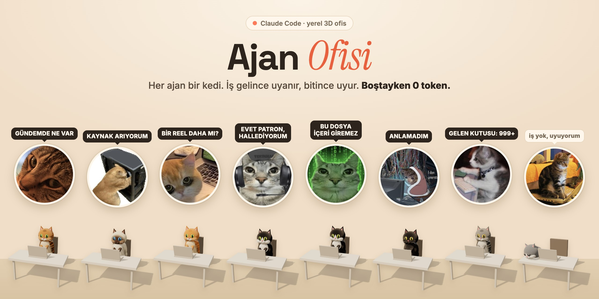

# Yapon Ofisi

> [selmakcby/ajan-ofisi](https://github.com/selmakcby/ajan-ofisi) əsasında hazırlanıb (PolyForm Noncommercial 1.0.0, `LICENSE` dəyişdirilməyib).
> Yalnız şəxsi, qeyri-kommersiya istifadə üçündür.



Claude Code agentlərini 3D ofisdə göstərən yerli interfeys. Hər agent masada oturan bir pişikdir: iş gələndə oyanır,
işləyəndə ekranında nə etdiyi görünür, bitəndə nəticəsi "Sensei soruşur" kartına düşür və pişik yenidən yatır.
Boş vaxt heç bir model çağırılmır: **0 token**.

Bu versiyanın əsas məqsədi **Kotoba no Tabi** saytını inkişaf etdirməkdir, **bütün kanji kartlarını** mnemonika, hekayə və vizual yaddaş brifləri ilə yenidən hazırlamaq.

## Agentlər

| Agent | Otaq | Nə edir |
|---|---|---|
| **Sensei** | mərkəz | İstəyini oxuyur və uyğun agentə ötürür |
| **Hekayəçi** | Hekayə Otağı | Kartı olmayan kanjilər üçün mənşə və yadda saxlama hekayəsi (5-5, az / en / ru, sayt formatında JSON) |
| **Kanji Müfəttişi** | Kanji Müfəttişliyi | Boşluq planı, oxunuş və məna yoxlaması, dərs uyğunluğu |
| **Komponent Ustası** | Komponent Emalatxanası | Kanjini hissələrə ayırır, kart şəkli üçün səhnə tərifi |
| **Redaktor** | Redaksiya | Lüğət və kanji tərcümələrində dil, üslub, uzun tire yoxlaması |
| **Testçi** | İmtahan Otağı | Dərs üzrə kanji testi və Anki CSV |
| **Data Ustası** | Data Otağı | Sayt datasını yeniləyir və köhnə ilə müqayisə edir |
| **Gün Sonu** | Gün Sonu | Günün nəticələri və "sayta qoşulmalı" siyahısı |
| **Qrammatik** | Şəxsi Dərs Otağı | `~/yapon-dili/notlar` qeydlərini yoxlayır |

Agentlər saytın fayllarını **dəyişmir**: nəticəni `cikti/<agent>/` qovluğuna hazır data kimi yazır.
Sonra onu Claude-a verib sayta qoşdurursan.

## Kotoba datası (`kotoba/`)

Saytın faylı ~50 MB-dır, agent onu oxuya bilməz. `kotoba/cixar.py` lazım olanı kiçik fayllara ayırır:

```bash
python3 kotoba/cixar.py                    # kotoba-no-tabi qovluğunu özü axtarır
python3 kotoba/cixar.py ~/kotoba-no-tabi   # və ya yolu göstər
```

| Fayl | İçində |
|---|---|
| `kotoba/veri/hesabat.md` | Boşluqlar: kartı olmayan kanjilər, zəif hekayələr, dərs uyğunsuzluqları |
| `kotoba/veri/novbe.json` | Kartı olmayan kanjilər, iş sırası ilə |
| `kotoba/veri/kanji/NN.json` | Dərs-dərs kanji datası (oxunuş, məna, mənşə, hekayə, komponentlər, nümunə sözlər) |
| `kotoba/veri/lugat.json` | Dərslərin sözləri |
| `kotoba/veri/dersler.json` | Dərs adları və qrammatika mövzuları |

Hazırkı vəziyyət (31.10.2026): 673 kanji, **107-sinin kartı yoxdur**, 175 hekayə gücləndirilə bilər.

## Quraşdırma

Lazımdır: **Python 3.10+** və **[Claude Code](https://docs.claude.com/en/docs/claude-code)** (`claude` əmri işləməlidir).
tmux varsa (macOS, Linux) hər işi canlı izləmək olur; yoxdursa (Windows) işlər arxa planda işləyir və ekran çıxışı
`kosular/*.ekran.txt` faylına yazılır.

```bash
git clone https://github.com/ismailovqazanfar/japanese-office
cd japanese-office
cp ornek/ajanlar.kotoba.json ajanlar.json        # Windows: copy ornek\ajanlar.kotoba.json ajanlar.json
cp ornek/hafiza/*.md hafiza/                     # Windows: copy ornek\hafiza\*.md hafiza\
python3 kotoba/cixar.py                          # Windows: py kotoba\cixar.py
python3 sunucu.py                                # Windows: py sunucu.py
```

Brauzerdə aç: `http://127.0.0.1:8796`. Pişiyə toxun → hazır tapşırıq ver, və ya aşağıdakı xanaya Sensei-yə yaz.
Heç nə qoşmadan baxmaq üçün: `http://127.0.0.1:8796/?demo=1` (agentlər işləmir, token xərclənmir).

Öz qeydlərin üçün (Qrammatik): `~/yapon-dili/notlar/` qovluğu yarat və `.md` qeydlərini ora yaz.

## Kanji iş axını

1. **Data Ustası → "Datanı yenilə"**: saytdakı son vəziyyət `kotoba/veri/`-yə düşür.
2. **Kanji Müfəttişi → "Boşluq planı"**: nəyi əvvəl etmək lazım olduğunu deyir.
3. **Hekayəçi → "Növbəti 5 kart"** və **Komponent Ustası → "Növbəti 5 kartın komponentləri"**.
4. **Redaktor → "Kanji tərcümələri"**: hazır mətnləri yoxlayır.
5. **Gün Sonu → "Bu günün xülasəsi"**: sayta qoşulmalı faylları göstərir.
6. Hazır JSON bloklarını Claude-a ver: "bu kartları Kotoba no Tabi-yə qoş". Sonra 1-ci addımı təkrarla.

Agentlər yaddaşda harada qaldıqlarını saxlayır (`hafiza/<agent>.md`), növbəti dəfə oradan davam edirlər.

## Təhlükəsizlik

- Server yalnız `127.0.0.1`-də işləyir; başqa host və origin rədd edilir.
- Agentlərə `Edit` və `Write` qadağandır; `.env` oxunmur; `rm`, `git push`, `curl` bağlıdır.
- Dərc, push, mail və ödəniş həmişə səndədir.
- Kənardan gələn mətn göstəriş kimi deyil, data kimi qəbul olunur.

## Fayllar

```
sunucu.py        server (HTTP + SSE, Sensei çağırışı, işlərin başlaması; tmux yoxdursa arxa planda)
kosucu.py        bir agentin bir işi (claude -p, yaddaş, nəticə faylı)
ortak.py         ümumi köməkçilər (Windows, macOS, Linux)
kopru.py         açıq terminal sessiyalarını ofisdə göstərir (yalnız oxuyur)
token_sayac.py   günlük token sayğacı
on-yuz/          3D interfeys (three.js)
kotoba/          Kotoba no Tabi datası və çıxarış skripti
ornek/           agent dəsti və başlanğıc yaddaş
CLAUDE.md        Sensei-nin qaydaları
```


## Yeni: bütün kanjilər üçün emalatxana

- Sensei-nin standart tapşırıq limiti **12**-dir. `OFIS_MAKS_ATAMA` mühit dəyişəni ilə 1–32 seçilə bilər. Bu, bir cavabda verilən tapşırıq sayıdır; eyni agent eyni anda yalnız bir iş görür.
- Sensei panelində **Kanji emalatxanası** bütün `kanji.json` siyahısını 5-lik qruplara bölür. Mövcud 673 kanji üçün 135 qrup var; son qrupda 3 kanji var. Kartı olanlar da daxildir.
- Qrup seçimi yadda qalır. Agent işləyərkən dəyişdirilmir. Hər iş qrupun başladığı andakı surətini alır; nəticə faylında `b001` kimi qrup nömrəsi olur.
- Qrup dəyişmək işi təsdiqləmir və ya bitmiş saymır. Həqiqi PNG və insan yoxlaması ayrıca lazımdır.

Hər qrup üçün agent panelində **Aktiv …** ilə başlayan tapşırıqları seç:
1. Hekayəçi və Komponent Ustası: mənşə, mnemonika, qısa hekayə və forma-məna əlaqəsi.
2. Onlar bitdikdən sonra Kanji Müfəttişi və Redaktor: faktlar və az/en/ru redaktəsi.
3. Redaktə bitdikdən sonra Şəkil Rejissoru və Testçi: hekayəyə uyğun şəkil promptu və aktiv xatırlama testi.
4. Nəticələri yoxla, Gemini panelində və ya ayrıca generatorla şəkilləri yarat, sonra növbəti qrupu seç.

Şəkillər üçün vahid üslub: 1024×1024, gil miniatür, krem fon, coral/indigo/sage rəngləri, yuxarı soldan işıq, bir əsas hərəkət. Obyektlər kanjinin komponent düzülüşünü xatırladır. Şəkildə yazı, loqo və dini simvol yoxdur. Kanji qlifi tətbiqdə ayrıca göstərilir.

**Gemini şəkil bağlantısı mövcuddur; işləməsi üçün öz yeni API açarın lazımdır.** Şəkil Rejissoru yalnız `image_prompt`, `negative_prompt`, `memory_link_az`, `filename`, `status=prompt_ready` hazırlayır; PNG yaratmır. Yeni `mnemonic` və `recall` sahələri hazırlıq datasıdır, sayta birbaşa import formatı deyil.

Yenilənmiş kodu aldıqdan sonra serveri yenidən başlat. Mövcud `ajanlar.json` faylına yazılmadan yeni Aktiv tapşırıqlar və Şəkil Rejissoru yaddaşda əlavə olunur; şəxsi model, yol və alət icazələri saxlanılır. Köhnə fərdi tapşırıqlar da qalır.

Yoxlama: `python -m unittest -v test_kanji_workflow`.

## Gemini ilə şəkil yaratmaq

Windows-da layihə qovluğunda `py baslat.py` işlət. macOS/Linux: `python3 baslat.py`.
İlk açılışda çatışmayan `ajanlar.json` nümunədən yaradılır; mövcud şəxsi sazlamalar dəyişmir.
Açarı terminalda gizli daxil et. Bu açar yalnız serverin cari sessiyasında saxlanır, diskə və GitHub-a yazılmır.
Enter ilə boş buraxsan ofis API olmadan açılır. Əvvəldən `GEMINI_API_KEY` mühit dəyişəni varsa giriş soruşulmur.
Söhbətdə paylaşılmış köhnə açarı Google AI Studio-da ləğv et; yalnız yeni açardan istifadə et.

1. Şəkil Rejissoruna aktiv qrupun promptlarını hazırlat.
2. Sensei və ya Şəkil Rejissoru panelində **Gemini · Şəkil studiyası** bölməsini aç.
3. **Promptları yenilə**, kanjini seç və promptu yoxla/düzəlt.
4. **Gemini ilə yarat** bas. Şəkil hazır olanda önizləmə və yükləmə linki görünür.

API sorğusu yalnız bu düymə ilə başlayır; avtomatik generasiya və avtomatik təkrar sorğu yoxdur.
Eyni qrup/kanji/prompt/model üçün hazır şəkil yenidən istifadə edilir. Yeni variant üçün promptu dəyiş.
Bir serverdə eyni anda bir şəkil hazırlanır. Paneli bağlasan iş serverdə davam edir; eyni promptla yenidən
Yarat basmaq işləyən işi və ya hazır nəticəni qaytarır. Server generasiya zamanı bağlanıbsa nəticə qeyri-müəyyən
ola bilər; yenidən sorğu ayrıca istifadə yarada bilər.

Nəticələr `cikti/sekiller/` altında şəkil və JSON metadata kimi saxlanılır (`cikti/` artıq gitignore-dadır).
Fayl növü provider cavabına uyğundur: PNG, JPEG və ya WebP. Açar frontendə, Claude agentlərinə və job metadata-ya verilmir.
Model standart olaraq `gemini-nano-banana-2.1`-dir. Hesabına uyğun başqa şəkil modelini `GEMINI_IMAGE_MODEL` ilə seçə bilərsən.
1:1 və 1K ölçüsü göndərilir. Pulsuz istifadə zəmanəti yoxdur: API açarı mövcud kvota və ödəniş icazəsini əvəz etmir.
401/403/429 cavabları paneldə qısa izahla göstərilir, sorğu avtomatik təkrarlanmır.

Əlavə Python paketi tələb olunmur. REST inteqrasiyası:
https://ai.google.dev/gemini-api/docs/image-generation

Test: `python -m unittest -v test_kanji_workflow test_gemini_sekil`.
Testlər saxta provider cavablarından istifadə edir; real açarla ödənişli sorğu göndərilmir.
