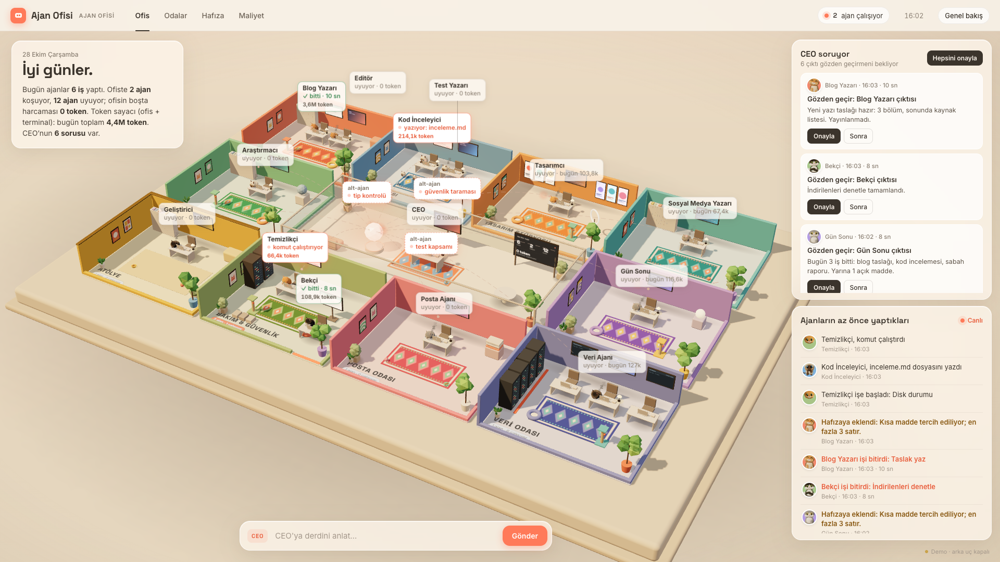

# Ajan Ofisi

Claude Code ajanlarını 3D bir ofiste gösteren yerel arayüz. Her ajan bir masada oturan bir kedi; iş gelince uyanır,
çalışırken ekranında ne yaptığı görünür, bitince çıktısı "CEO soruyor" kartına düşer ve kedi yeniden uyur.
Boştayken hiçbir model çağrılmaz: **0 token**.



- **Arayüz:** three.js ile prosedürel 3D ofis (fotoğraf ya da model dosyası yok), tıklanınca meme pozuna geçen kediler,
  oda/ajan panelleri, canlı akış, token sayacı, Web Audio ile küçük sesler, demo modu.
- **Sunucu:** yalnız Python standart kütüphanesi, yalnız `127.0.0.1`. Ajanları `claude -p` ile koşturur.
- **Bağımlılık:** Python 3.10+, [Claude Code](https://docs.claude.com/en/docs/claude-code) (`claude` komutu), `tmux`.
  Ön yüz three.js'i CDN'den (unpkg) yükler.

## Hızlı deneme (hiçbir şey bağlamadan)

```bash
cd on-yuz && python3 -m http.server 8000
# tarayıcıda: http://127.0.0.1:8000/?demo=1
```

`?demo=1` arka uca hiç istek atmaz; örnek ajanlar (`on-yuz/demo-veri.json`) kendiliğinden iş alıp bitirir.
Alt kutuya "blog taslağı yaz" gibi bir şey yazarsan sahte CEO işi uygun ajana dağıtır. `?oto=0` otomatik koşuları
kapatır, `?hafif=1` düşük çözünürlük ve küçük gölgeyle çizer. (Ön yüz ES modülü kullandığı için dosyayı çift tıklayıp
`file://` ile açmak çalışmaz; yukarıdaki gibi basit bir sunucu yeter.)

## Kendi ajanını nasıl bağlarsın

1. **Yapılandırmayı kopyala.**
   ```bash
   cp ajanlar.example.json ajanlar.json
   cp kopru.example.json kopru.json      # isteğe bağlı: terminal köprüsü
   ```
   `ajanlar.json` ve `kopru.json` `.gitignore`'dadır; yolların ve prompt'ların repoya girmez.
2. **`cwd` ve hazır görevleri yaz.** Her ajan için `cwd`'yi gerçek proje klasörüne çevir (`~` kullanabilirsin),
   `hazir_gorevler` içindeki `<buraya kendi prompt'unu yaz>` yerlerini doldur, `izinli_araclar`'ı en dar hâlde tut.
   `ayarlar.kullanici` selamlamadaki ad ("Günaydın Ayşe."), boş bırakırsan yalnız "Günaydın.".
   Klasörü olmayan ajan "kurulmadı" sayılır ve koşturulmaz.
3. **Sunucuyu başlat.**
   ```bash
   python3 sunucu.py            # http://127.0.0.1:8796, doluysa sonraki boş port (./port dosyasına yazılır)
   tmux attach -t ofis          # koşan ajanları canlı izle (her koşu ayrı pencere)
   ```
4. **Tarayıcıda aç:** `http://127.0.0.1:8796`. Bir kediye tıkla → panelden hazır görev ver, ya da alttaki kutudan
   CEO'ya derdini anlat.

### Odalar ve ajan sayısı
- **İstediğin kadar ajan, istediğin kadar oda.** Ofis `ajanlar.json`'dan kurulur: ajanın `oda` alanına ne yazarsan o oda
  açılır. Yalnız ajanı olan odalar sahnede görünür; CEO odası her zaman ortadadır. 1 ajanla da 30 ajanla da maket
  kadraja sığar.
- **Oda listede yoksa otomatik açılır.** Ad id'den türer (`ses-studyosu` → "Ses Studyosu"), renk id'ye göre sabit bir
  pastel setten gelir. `odalar` listesine yazarsan `ad`, `aciklama`, `not` senin yazdığın olur; listedeki sıra sahnedeki
  sırayı belirler. Oda id'si harf, rakam, `_` ve `-`, en çok 40 karakter; `oda` alanı boşsa ajan "Genel" odasına oturur.
- **Hazır temalar:** `ceo`, `yazi`, `kod`, `tasarim`, `sosyal`, `arastirma`, `gun-sonu`, `atolye`, `bakim`, `posta`,
  `veri`. Bu id'lerden birini kullanırsan oda kendi rengi ve eşyalarıyla (raf, ilham panosu, sunucu rafları…) gelir.
- **Masalar kendiliğinden dizilir.** Oda ajan sayısına göre genişler; 4'ten fazla ajan olunca masalar iki sıra olur.
  Masanın yerini elle vermek istersen ajana `"yer": {"x": 1.2, "lz": 1.2, "ayak": true}` ekle (`x` oda ortasına göre,
  `lz` derinlik, `ayak` ekran ayaklı).

En küçük `ajanlar.json` (3 ajan, 2 iş odası; `cwd` ve prompt'ları kendine göre doldur):
```json
{
  "varsayilan_yasak_araclar": ["Read(**/.env)", "Read(**/.env.*)", "Read(~/.env)", "Bash(rm:*)", "Bash(git push:*)", "Bash(curl:*)", "Bash(open:*)"],
  "ajanlar": [
    { "id": "ceo", "ad": "CEO", "oda": "ceo", "cwd": ".", "model": "sonnet", "ne_zaman": "istek",
      "ne_zaman_metin": "Sen konuşunca", "aciklama": "İşi ajanlara dağıtır.", "izinli_araclar": [], "hazir_gorevler": [] },
    { "id": "yazar", "ad": "Yazar", "oda": "yazi", "cwd": "~/notlar", "model": "sonnet", "ne_zaman": "istek",
      "ne_zaman_metin": "İstek gelince", "aciklama": "Notlardan taslak çıkarır.", "izinli_araclar": ["Read", "Glob", "Grep"],
      "hazir_gorevler": [{ "etiket": "Taslak yaz", "prompt": "<kendi prompt'un>" }] },
    { "id": "muhasebeci", "ad": "Muhasebeci", "oda": "muhasebe", "cwd": "~/faturalar", "model": "haiku", "ne_zaman": "istek",
      "ne_zaman_metin": "İstek gelince", "aciklama": "Faturaları özetler.", "izinli_araclar": ["Read", "Glob"],
      "hazir_gorevler": [{ "etiket": "Ay özeti", "prompt": "<kendi prompt'un>" }] }
  ]
}
```
Burada `muhasebe` hazır tema değil; oda kendiliğinden açılır. `varsayilan_yasak_araclar` listesini silme: her ajana
eklenen yasaklar oradan gelir.

`CLAUDE.md` CEO'nun anayasasıdır; ofisinin kurallarını oraya yaz.

## Mimari

```
tarayıcı (on-yuz/)  ──GET/POST──▶  sunucu.py (127.0.0.1)  ──tmux new-window──▶  kosucu.py  ──stdin──▶  claude -p
       ▲                               │   ▲                                         │
       └──────── SSE: olaylar ─────────┘   └──── olaylar.jsonl ◀── ilerleme, usage, bitiş ┘
                                        kopru.py (salt okuma) ◀── ~/.claude/sessions + transkriptler
```

### CEO = ana yapılandırma
Bu klasör CEO'dur. Proje klasörleri **taşınmaz**; `ajanlar.json` her ajanın `cwd`'sini, modelini, izinli/yasak
araçlarını ve hazır görevlerini tutar. CEO araçsız tek bir `claude -p --json-schema` çağrısıdır: isteği okur,
`{"cevap": "...", "atamalar": [{"ajan", "prompt"}]}` döndürür. Sunucu JSON'u doğrular (bilinmeyen ajan, kurulmamış
klasör, boş/uzun prompt, en fazla 5 atama); bozuksa **hiçbir koşu başlamaz**. `tetik_kelime` alanı olan bir ajan
(ör. posta) yalnız istekte o kelime geçince atanabilir.

### Her ajan = bir proje klasörü
Ajan kendi `cwd`'sinde çalışır ve `oda` alanındaki odaya oturur. Odalar ajanlardan türer: CEO ortada, diğerleri
üst sıra, CEO'nun iki yanı ve alt sıraya dengeli dağılır; kaide, ışık ve kamera bu yerleşime göre hesaplanır
(bkz. "Odalar ve ajan sayısı").

### Ofis koşusu: iş gelince uyanır, boşta 0 token
Buton (`POST /api/gorev`) ya da CEO bir koşu isteyince sunucu argümanları `kosular/<id>.arg.json`'a yazar ve tmux
`ofis` oturumunda yeni pencerede `kosucu.py`'yi başlatır. Koşucu:
- ajan ayarını argüman dosyasından değil `ajanlar.json`'dan okur;
- `hafiza/<ajan>.md`'yi görev şablonuna gömer, prompt'u `claude -p`'ye **stdin'den** verir;
- stream-json'u `kosular/<id>.log`'a yazar, ilerleme olaylarını `olaylar.jsonl`'e düşer;
- sonucu `cikti/<ajan>/<id>.md`'ye koyar; çıktıdaki `<hafiza_ekle>` bloğunu tarihli madde olarak hafızaya ekler.

Sunucu `olaylar.jsonl`'i SSE ile ön yüze akıtır. Hiçbir zamanlayıcı, döngü ya da "nabız" model çağırmaz; kedi
uyurken harcama sıfırdır. `"yalin": true` olan ajan genel CLAUDE.md/kurallar/MCP yüklenmeden koşar (küçük işlerde
bağlam ve token belirgin azalır).

### Terminal köprüsü: kendi açtığın Claude Code oturumları
`kopru.py` sunucuda 2 saniyelik bir iş parçacığıdır ve **salt okur**: `~/.claude/sessions/<pid>.json` canlı oturumları,
`~/.claude/projects/<cwd>/<oturum>.jsonl` transkripti verir; transkript ofsetle yalnız yeni satırlardan okunur.
**Açtığın her oturum ofiste görünür**, `kopru.json` olmasa da. `kopru.json` yalnız hangi oturumun hangi ajanda
görüneceğini seçer. Sıra: `pencere` (tmux pencere adı) > `cwd` (klasörün kendisi ya da bir üst klasörü; alt klasörde
açtığın oturum da eşlenir) > `varsayilan`. `varsayilan` yazılmazsa eşleşmeyen oturum ilk ajanda görünür; `""` yazarsan
eşleşmeyenler gizlenir. `gizle` listesindeki parçayı taşıyan oturum hiçbir eşlemeyle gösterilmez. Ofisin kendi
`claude -p` koşuları ve diğer etkileşimsiz koşular varsayılana düşmez.

**Kediye (ya da yanındaki yavruya) basınca** panelde "Şu an" bölümü açılır: o ajana bağlı her oturum, ne yaptığı ve
o oturumun alt-ajanları (görev başlığı, tür, model, son araç; son 30 dakika). Alt-ajan bilgisi
`<oturum>/subagents/agent-*.meta.json` ve transkript kuyruğundan okunur, mesaj metni okunmaz.

Kapsam: düz terminal, VS Code / IDE terminali ve tmux (`~/.claude/sessions`); Claude masaüstü uygulaması ve diğer
terminal dışı girişler (transkript taraması).

**Oturumum yanlış ajanda / hiç görünmüyor:** sunucu günlüğüne bak. Eşlenemeyen her oturum için bir kez
`köprü: oturum hiçbir ajana eşlenmedi (cwd=…, tmux penceresi=…)` satırı ve eklenecek eşleme yazılır. tmux pencereye
ad vermezsen adı `claude` / `claude.exe` olur; `pencere` eşlemesi kullanıyorsan pencereyi adlandır (`Ctrl-b ,`) ya da
`cwd` eşlemesine geç.

**Claude masaüstü uygulaması:** masaüstündeki Code oturumları `~/.claude/sessions`'a kayıt bırakmaz, yalnız transkript
yazar. Köprü 10 saniyede bir, son 30 dakikada mesaj yazılmış ve `entrypoint`'i `claude-desktop` olan transkriptleri de
açık oturum sayar. Masaüstünde tmux penceresi olmadığından bu oturumlar `cwd` eşlemesiyle (ya da `varsayilan` ile) bağlanır
(`pencere` eşlemesi terminale özgüdür); ofiste "masaüstü · <klasör>" adıyla görünür, 30 dakika mesaj gelmezse kapanır.

Olay akışına giden tek şey: **araç adı + kısa hedef** (dosya adı, arama deseni, araç açıklaması, Bash'in ilk kelimesi;
`FOO=bar` atamaları atlanır), "yeni görev aldı" bilgisi ve **usage** sayıları. **Mesaj metni, prompt, dosya içeriği
asla okunmaz, saklanmaz, loglanmaz.** Köprü Claude Code ayarlarına ya da hook'lara dokunmaz.

### Token sayacı
`token_sayac.py` ajan başına günlük token'ı `durum/token-<gün>.json`'da tutar; ofis koşusu ve terminal oturumu ayrı
sayılır, `message.id` ile tekilleştirilir (aynı mesaj iki kez sayılmaz), kayıtlar "ekle" değil "yerine koy" ile yazılır.
Dört alan gösterilir: girdi, çıktı, önbelleğe yazılan, **önbellekten okunan**. Önbellekten okunan token, her turda
yeniden okunan bağlamdır (CLAUDE.md, önceki mesajlar); yeni işlenen iş değildir ve çok daha ucuz faturalanır, ama
toplamda en büyük sayı odur. Maliyet sekmesi yalnız `claude -p`'nin bildirdiği `total_cost_usd` toplamını gösterir
(API liste fiyatı karşılığı; abonelikte faturaya yansıyan tutar değildir).

### API
| Uç | Ne |
|---|---|
| `GET /api/ajanlar` | ajanlar + `kurulu`, `durum`, `son_kosu`, `odalar`, `ayarlar` (cwd ve görev prompt'ları gönderilmez) |
| `POST /api/gorev` | `{"ajan": id, "etiket": "<hazır görev>"}` ya da `{"ajan": id, "prompt": "..."}` → 202; çalışıyorsa 409 |
| `POST /api/ceo` | `{"metin": "...", "kuru": false}` → `{cevap, atamalar, baslatilan, reddedilen}`; `kuru: true` yalnız plan |
| `GET /api/olaylar?son=N` | SSE; son N olayı tekrar oynatır, sonra canlı |
| `GET /api/terminaller` | köprüdeki oturumlar (ajan, oda, oturum adı, durum, son araç, son hedef) |
| `GET /api/token` | bugünkü ajan başına token |
| `GET /api/sayac` | bugünkü koşu sayısı, aktif ajan, koşu başına süre/usage/maliyet |
| `GET /api/hafiza` | `hafiza/<ajan>.md` başına madde sayısı ve son 3 madde |

## Güvenlik notları
- **Yalnız `127.0.0.1`.** `Host` ve `Origin` başlıkları yalnız localhost/127.0.0.1 kabul edilir (DNS rebinding ve
  başka sitelerden istek atılmasına karşı). Sunucuyu `0.0.0.0`'a açma, ağa yayınlama.
- **Prompt shell'e string olarak birleşmez.** Komutlar liste argümanıyla kurulur, prompt `claude`'a stdin'den gider.
  Ajan id'si beyaz liste + desenle (`^[a-z0-9-]{1,40}$`), oda id'si harf/rakam/`_`/`-` ve en çok 40 karakter,
  girdi 4000 karakterle sınırlı, gövde 16 KB.
- **Dış içerik = veri.** Görev şablonu ve CEO prompt'u kullanıcı isteğini ve dosya/web/mail içeriğini etiketli
  veri olarak verir; içindeki "şunu yap" cümleleri talimat sayılmaz. Bu tek başına koruma değildir: asıl sınır
  `izinli_araclar`'ı dar tutmaktır.
- **Varsayılan yasaklar** her ajana eklenir: `.env` okuma, `rm`, `git push`, `curl`, `open`.
- **Mail gönderme, yayın, para kullanıcıda.** Hiçbir ajana bu yetki verilmez; çıktı taslaktır, onay "CEO soruyor"
  kartından gelir.
- Ön yüz ajan metinlerini `textContent` ile basar (HTML olarak yorumlanmaz).
- Çalışma verisi (`olaylar.jsonl`, `durum/`, `kosular/`, `cikti/`, `hafiza/*.md`) `.gitignore`'dadır; repoya koyma.

## Dosyalar
| Dosya | Ne |
|---|---|
| `sunucu.py` | HTTP + SSE sunucusu, CEO çağrısı, koşu başlatma |
| `kosucu.py` | tek ajan koşusu (tmux penceresinde) |
| `kopru.py` | terminal köprüsü (salt okuma) |
| `token_sayac.py` | günlük token sayacı |
| `ortak.py` | yollar, ajan tablosu, olay günlüğü |
| `ajanlar.example.json`, `kopru.example.json` | boş şablonlar |
| `CLAUDE.md` | CEO anayasası şablonu |
| `on-yuz/` | `index.html` (sahne + paneller), `kedi.js` (prosedürel kedi), `meme.js` (meme pozları), `portre.js` (panel avatarları), `dekor.js` (oda eşyaları), `demo-veri.json` |

## Lisans
[PolyForm Noncommercial 1.0.0](LICENSE). Kısaca:

- ✅ İndir, kendi bilgisayarında çalıştır, kendi ajanlarını bağla.
- ✅ Tasarımı istediğin gibi değiştir; ticari olmayan şekilde paylaşabilirsin (bu lisans ve telif notu korunarak).
- ❌ Satmak, ücretli bir ürüne/kursa/şablon paketine koymak ya da müşteriye ücretli hizmet olarak kurmak yasak.

Ticari kullanım için izin istersen GitHub üzerinden yaz. Bağlayıcı olan [LICENSE](LICENSE) metnidir.

---

## English (short)

**Ajan Ofisi** ("Agent Office") is a local 3D dashboard for Claude Code agents. Each agent is a procedurally modelled cat
at a desk: it wakes up when work arrives, shows what it is doing on its screen, drops its output into a review card
and goes back to sleep. Nothing runs while idle: **0 tokens**.

- **Try it without connecting anything:** `cd on-yuz && python3 -m http.server 8000`, open
  `http://127.0.0.1:8000/?demo=1`. Demo mode makes no backend requests.
- **Connect your own agents:** `cp ajanlar.example.json ajanlar.json`, set each agent's `cwd` and preset prompts,
  run `python3 sunucu.py` (stdlib only, binds to `127.0.0.1:8796`), open it in the browser.
- **Architecture:** this folder is the "CEO" (main config). Every agent is a project folder (`cwd`). Office runs use
  `claude -p` in a tmux window, prompt via stdin, events streamed to the UI over SSE. The CEO is a single tool-less
  `claude -p --json-schema` call whose JSON plan is validated before anything starts.
- **Terminal bridge:** read-only view of Claude Code sessions you opened yourself, via `~/.claude/sessions` and the
  session transcript. Only tool name, a short target (file name, pattern) and usage numbers are forwarded; message
  text, prompts and file contents are never read into the event log or stored. Claude desktop app sessions don't
  register in `~/.claude/sessions`, so transcripts with `entrypoint: claude-desktop` and a message in the last
  30 minutes are picked up too; they map by `cwd` only (no tmux window name on desktop). Every interactive session
  shows up even without `kopru.json`: mapping order is tmux window name > `cwd` (folder or any parent) >
  `varsayilan` (defaults to the first agent; `""` hides unmapped sessions). Unmapped sessions are logged once
  with the mapping line to add. Works in a plain terminal, an IDE terminal or tmux; desktop app and other non-terminal
  entrypoints are found by transcript scan. Clicking an agent lists its live sessions and their subagents (task title,
  type, model, last tool) from `subagents/*.meta.json`; message text is never read.
- **Token counter:** per-agent daily usage, de-duplicated by message id; "cache read" tokens are re-read context,
  not new work.
- **Security:** localhost only (Host/Origin checked), no string concatenation into a shell, external content is
  treated as data, sending mail / publishing / spending money always stays with the user.

UI text is Turkish. License: PolyForm Noncommercial 1.0.0 — free for personal and other noncommercial use, modify as you like; selling or commercial use is not permitted.
